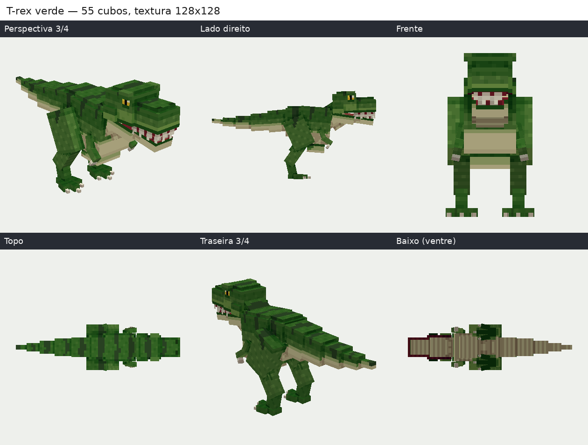
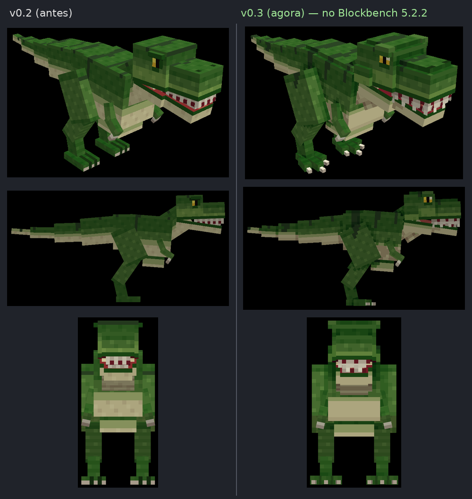
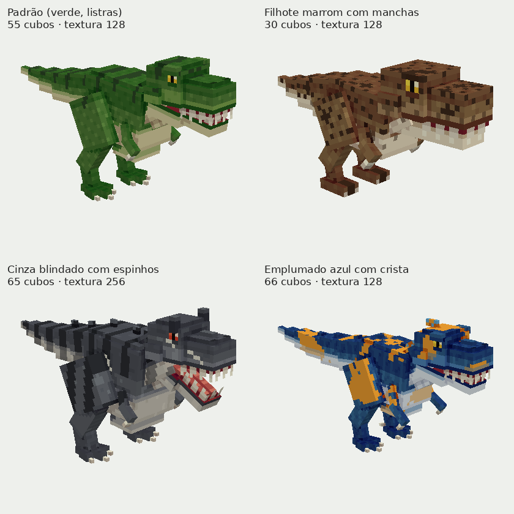

# 🦖 Ninho Model Studio

Gera **modelos 3D estilo Minecraft** para o **Blockbench** a partir de uma descrição, tudo pelo
navegador do celular, no **Google Colab gratuito**, com uma **IA de pesos abertos** e sem APIs
pagas. Primeira versão: **T-rex ajustável**.

**[▶ Abrir no Colab](https://colab.research.google.com/github/Ninhoplayer6gg/models-N/blob/ccr-95e0f983-pm7raa/Ninho-Model-Studio.ipynb)**
· guia: **[usar pelo celular](docs/GUIA-CELULAR.md)**
(depois de mesclar na `main`, troque `ccr-95e0f983-pm7raa` por `main` no link)



**v0.3 — T-rex mais bonito:** nova forma (cabeça com sobrancelhas e bochechas, dentes em
zigue-zague com gengiva, língua, pés com três dedos e garras, corpo e cauda mais robustos) e
textura com sombra de contato calculada pela geometria. Antes × agora, no Blockbench 5.2.2:



## O que tem aqui

| Entrega | Onde |
|---|---|
| Notebook do Colab, 5 etapas em português, controles de toque | [`Ninho-Model-Studio.ipynb`](Ninho-Model-Studio.ipynb) |
| Código-fonte | [`ninho_studio/`](ninho_studio/) |
| Exemplo T-rex verde (`.bbmodel`, `.png`, `.json`, `.zip`, prévias, visualizador 3D) | [`examples/trex-verde/`](examples/trex-verde/) |
| T-rex branco do **primeiro teste real da IA no Colab** (com antes/depois das correções) | [`examples/trex-branco-ia/`](examples/trex-branco-ia/) |
| Verificação no Blockbench 5.2.2 (capturas, relatório, `.geo.json`, pose de teste) | [`examples/trex-verde/blockbench/`](examples/trex-verde/blockbench/) |
| **Minecraft Java (GeckoLib):** o que já está pronto, onde os arquivos ficam e o que falta | [`docs/MINECRAFT-JAVA.md`](docs/MINECRAFT-JAVA.md) |
| Guia do celular · formato `.bbmodel` · IA · relatório de testes | [`docs/`](docs/) |

## Como funciona

```
descrição ──► [Modo IA] Qwen2.5-Coder-1.5B (local, no Colab) ──► JSON ──► validação (JSON Schema)
                                                                     │ erro → reparo (até 3×) → falha clara
controles ──► [Modo procedural] ───────────────────────────────────► │
                                                                     ▼
                         CreatureSpec validada + ajustes manuais + seed
                                                                     ▼
   construtor (ossos, pivôs, cubos) → atlas box UV → textura PROCEDURAL → .bbmodel 5.0 (bedrock)
                                                                     ▼
          validação do arquivo → prévias (lidas do próprio .bbmodel) → .png .geo.json .json .zip
```

* **Modo IA:** o modelo de linguagem lê a descrição e devolve só dados (tipo, proporções,
  cores, padrão, pele, detalhes). Nada gerado pela IA é executado: o JSON é extraído sem
  `eval`/`exec` e só é aceito se passar no esquema. Se falhar, o erro aparece e o notebook
  sugere o modo procedural — nunca troca sozinho.
* **Modo procedural:** os controles definem tudo; nenhuma IA envolvida.
* Em qualquer modo os controles finos (cabeça, cauda, pernas, cores, detalhe...) podem ser
  ajustados **sem reinstalar nada** (Etapas 3 e 4).

Detalhes da IA (licença Apache-2.0, compatibilidade, CPU/GPU): [`docs/IA-MODELO.md`](docs/IA-MODELO.md).

## O T-rex

* Ossos com pivô em cada articulação, prontos para animação:
  `root → body → {torso → {neck → head → jaw, arm_* → forearm_*}, tail_1 → … → tail_n,
  leg_* → shin_* → [metatarsus_*] → foot_*}`.
* Cabeça mais larga atrás (bochechas), **sobrancelhas salientes**, topo arredondado e ponte
  nasal; **mandíbula separada** com dobradiça e língua; dentes de cima por fora da mandíbula
  (mordida sobreposta); olhos com pupila em fenda e brilho; narinas; pescoço com garganta;
  dorso e quadril arredondados, peito; **braços pequenos com duas garras por mão**; coxa
  robusta e panturrilha; **pés com três dedos separados** (abertos em leque) e garras, bem
  apoiados no chão; **cauda em 4–6 segmentos que afinam**.
* Níveis de detalhe (baixo 30 cubos, médio 55, alto 64) e **orçamento de elementos**
  configurável (padrão 96); detalhes extras (sobrancelhas, garras dos pés, crista nasal,
  esporão, plaquinhas no dorso, espinhos, crista de penas, chifres) só entram se couberem.
* Tudo em pixels inteiros (box UV), posições na grade de 0,5 px, ângulos em passos de 0,5°.
  Faces de cubos diferentes que ficariam no mesmo plano (e piscariam no jogo) recebem um
  `inflate` de fração de pixel; o validador confere que não sobrou nenhuma.



## Textura (procedural)

Atlas box UV organizado por região (cabeça, corpo, cauda, pernas, braços), 128×128 ou
256×256 (sobe para 256 sozinho se não couber, com aviso). Cada texel é ligado ao ponto 3D
que cobre, então as regras pintam regiões intencionais: dorso escuro → laterais → **ventre
claro** com escamas ventrais e dobras na garganta, linha dos lábios, céu da boca e língua,
olhos, garras com degradê, anéis de escamas nos dedos; padrões **listras, manchas, faixas,
mosqueado** contínuos entre peças (listras com borda irregular, como pintadas à mão); pele de
**escamas, rugosa, lisa ou penas**. **Sombra de contato** calculada lançando raios contra os
próprios cubos (escurece embaixo da mandíbula, entre as pernas e o corpo, entre os dedos) e luz
na borda de cima de cada peça. Os **dentes** são recortados com transparência (zigue-zague com
gengiva), como o GeckoLib desenha. Paleta em rampas de tons, sem filtro: pixels nítidos.

## Exportação

* `.bbmodel` — projeto **editável** do Blockbench, `format_version` **5.0**, formato
  **`bedrock`**, campos iguais aos que o Blockbench 5.2.2 grava ([detalhes](docs/FORMATO-BBMODEL.md)).
* `.png` — textura. `.json` — modo, descrição, parâmetros, seed, versão, saída da IA,
  validação e hashes (regenerar a partir dele dá os mesmos bytes). `.zip` com tudo.
* `.geo.json` — **modelo para o Minecraft Java com o mod GeckoLib** (geometria Bedrock 1.12.0,
  que também serve no Bedrock). É idêntico, byte a byte, ao que o Blockbench exporta, e foi lido
  sem erros pelos leitores do GeckoLib 4 e 5 ([detalhes](docs/MINECRAFT-JAVA.md)). Ainda faltam
  as animações e o mod (`.jar`) que registra a criatura no jogo.

## Qualidade e testes

Validação automática de dimensões, UUIDs, referências, hierarquia, UV fora da textura,
consistência do box UV, sobreposição no atlas, faces sem pintura, pivôs, chão, faces no mesmo
plano (que piscariam no jogo) e `.geo.json`
do GeckoLib. 158 testes automáticos; os exemplos e 9 variantes foram **abertos no Blockbench 5.2.2** sem
avisos nem erros do validador dele, e o `.geo.json` de 12 casos foi conferido no Blockbench e
nos leitores do GeckoLib 4 e 5 compilados do código-fonte. A IA real (Qwen2.5-Coder-1.5B, GPU T4) já rodou no Colab
num teste do usuário: JSON válido na 1ª tentativa em 11 s; as falhas observadas e as correções
estão em [`docs/RELATORIO-DE-TESTES.md`](docs/RELATORIO-DE-TESTES.md).

## Desenvolvimento

```bash
python -m pytest -q                 # testes
python tools/build_notebook.py      # regenera o notebook após mudar o código
python tools/make_example.py        # regenera o exemplo e a galeria
```

Para adicionar outra criatura (outros dinossauros, quadrúpedes, humanoides): crie
`ninho_studio/builders/<plano>.py` com `build_with_budget(spec, settings)`, registre em
`builders/__init__.py` e acrescente a espécie em `spec.SPECIES` (ver [`tools/README.md`](tools/README.md)).

### Próximos passos sugeridos

1. Rodar o modo IA no Colab com 10–20 descrições variadas (o prompt mudou na v0.1.1) e anotar acertos.
2. Minecraft Java: animações (parado, andar, rugir) e o mod GeckoLib compilado numa etapa do Colab
   (precisa da versão do Minecraft e do carregador: Fabric, NeoForge ou Forge).
3. Novos planos corporais (raptor, quadrúpede, humanoide) reaproveitando atlas, textura e validação.
4. Opção de UV espelhado para lados esquerdo/direito (texturas ainda menores).
