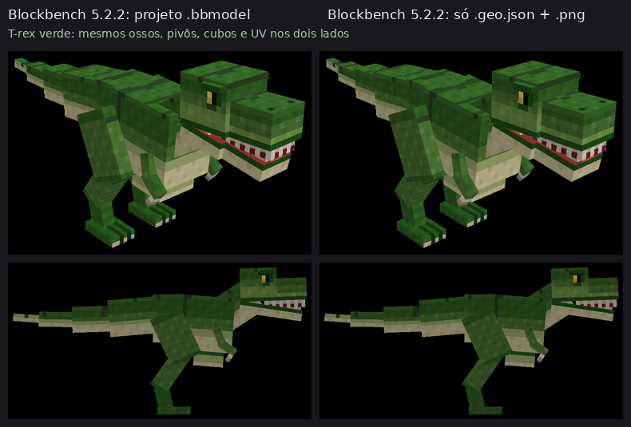

# Minecraft Java: o caminho com o GeckoLib

No Minecraft **Java**, uma criatura nova só entra no jogo por meio de um **mod**. O jeito padrão
de fazer criaturas animadas feitas no Blockbench é o mod **GeckoLib**, que funciona com Fabric,
NeoForge e Forge. Para usar o T-rex, são três peças:

| Peça | Situação |
|---|---|
| **Modelo** (`.geo.json`) e **textura** (`.png`) | ✅ **Pronto (v0.2.0).** Sai em toda geração, dentro do `.zip`. |
| **Animações** (`.animation.json`: parado, andar, rugir) | ⏳ Próxima etapa, depois que a forma do T-rex for aprovada. |
| **Mod** (`.jar`) que registra a criatura (entidade, renderizador, ovo de spawn) e usa o GeckoLib | ⏳ Próxima etapa. Depende da **versão do Minecraft** e do **carregador** (Fabric, NeoForge ou Forge). |

## O arquivo `.geo.json`

* É a geometria no formato que o GeckoLib lê (formato Bedrock `1.12.0`): ossos, pivôs,
  rotações, cubos e UV.
* É **o mesmo arquivo** que o Blockbench gera em *File → Export → Export Bedrock Geometry*. O
  plugin oficial do GeckoLib para o Blockbench usa esse mesmo exportador. O Ninho escreve o
  arquivo sozinho (`ninho_studio/geo.py`), sem precisar abrir o Blockbench.
* O mesmo arquivo também serve de geometria para o Minecraft **Bedrock**.

### Onde os arquivos ficam dentro de um mod

| GeckoLib | Versões do Minecraft | Modelo | Textura |
|---|---|---|---|
| **5** | 1.21.5 em diante (inclui 26.x) | `assets/<modid>/geckolib/models/entity/<nome>.geo.json` | `assets/<modid>/textures/entity/<nome>.png` |
| **4** | 1.20.1 a 1.21.4 | `assets/<modid>/geo/entity/<nome>.geo.json` | `assets/<modid>/textures/entity/<nome>.png` |

Essas pastas foram conferidas no código-fonte do GeckoLib (`GeckoLibResources` no 5,
`GeckoLibCache` e `DefaultedGeoModel` no 4). Quando o mod for gerado, o Ninho põe cada arquivo no
lugar certo. Você não vai precisar mexer nessas pastas.

## Como foi conferido (sem o Minecraft)

1. **Blockbench 5.2.2** (código oficial, rodando sem tela): em 12 casos (os 2 exemplos, 9 variantes
   e um caso sintético com cubo girado, cubo e osso espelhados e cubo inflado):
   * a exportação feita pelo próprio Blockbench saiu **idêntica, byte a byte**, ao `.geo.json` do Ninho;
   * o `.geo.json` aberto **sozinho** com o `.png` reproduziu exatamente ossos, pivôs, rotações,
     cubos, UV das faces e caixa do modelo; as capturas de tela diferem em no máximo 0,11% dos
     pixels, só onde faces de cubos diferentes ficam no mesmo plano (veja "A corrigir" abaixo);
   * resultado em [`verificacao-geckolib.json`](verificacao-geckolib.json).

   
2. **Leitores do próprio GeckoLib**, compilados do código-fonte original: **GeckoLib 4.9.3**
   (Minecraft 1.21.1) e **GeckoLib 5.5.7** (Minecraft 26.3). Só as classes do Minecraft foram
   trocadas por versões mínimas, porque o Minecraft não roda aqui.
   * os dois leram os 12 arquivos **sem erro nem aviso** e aceitaram a versão `1.12.0`;
   * ossos, pivôs, rotações e tamanhos iguais ao projeto; **9.648 cantos de face** conferidos: a
     posição e o UV de cada canto caem no mesmo ponto que no Blockbench (a textura fica no lugar
     certo);
   * **controle negativo:** 5 defeitos plantados de propósito (UV deslocado 1 pixel, sinal de
     rotação trocado, X sem espelhar na origem e no pivô, espelhamento indevido) foram todos
     acusados nas duas versões;
   * resultado em [`verificacao-geckolib-leitor.json`](verificacao-geckolib-leitor.json).

**Ainda não testado:** o T-rex dentro do jogo (renderização, tamanho da caixa de colisão,
iluminação), porque isso exige o mod rodando no Minecraft.

**A corrigir (achado nesta conferência):** em alguns pontos, faces de cubos diferentes ficam no
mesmo plano e viradas para o mesmo lado. Isso acontece no cotovelo (lateral do braço e do
antebraço) em todos os modelos. Em algumas combinações acontece também nos dentes (detalhe
baixo), entre o pescoço e a mandíbula, nas sobrancelhas e nas garras dos pés. Nesses pontos, a
face que aparece depende da ordem de desenho, o que pode "piscar" no jogo. O defeito está no
modelo, não na exportação. A correção (afastar essas faces uma fração de pixel) entra junto com
as animações, que mudam a posição dessas partes.

## Por que o mod ainda não vem pronto

* O código do mod muda conforme a versão do Minecraft e o carregador. GeckoLib 4 e 5, por
  exemplo, têm APIs de renderização diferentes.
* Este ambiente de desenvolvimento não acessa os repositórios do Fabric, do NeoForge, do Forge
  nem os arquivos do Minecraft. Por isso, um `.jar` feito aqui não poderia ser compilado nem testado.
  O plano é uma etapa no Colab, que tem internet, para **compilar o mod e entregar o `.jar`**.
* Para isso, preciso saber: a **versão do Minecraft Java**, o **carregador** (Fabric, NeoForge
  ou Forge) e **como você joga** (no Android, o Java roda por launchers não oficiais; nenhum foi
  testado aqui).
